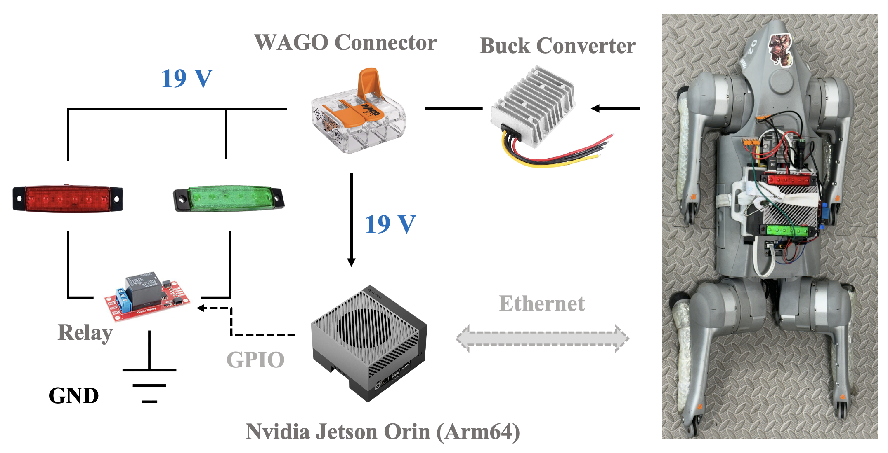
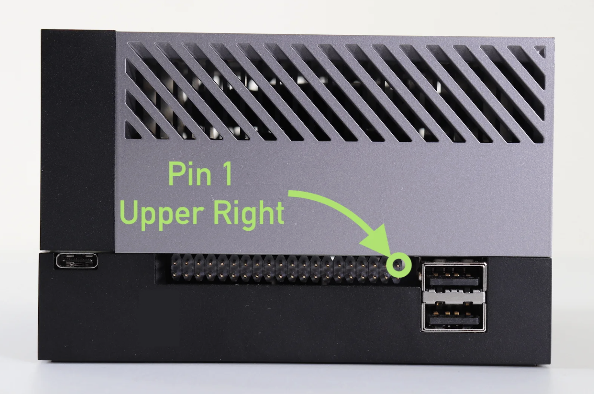
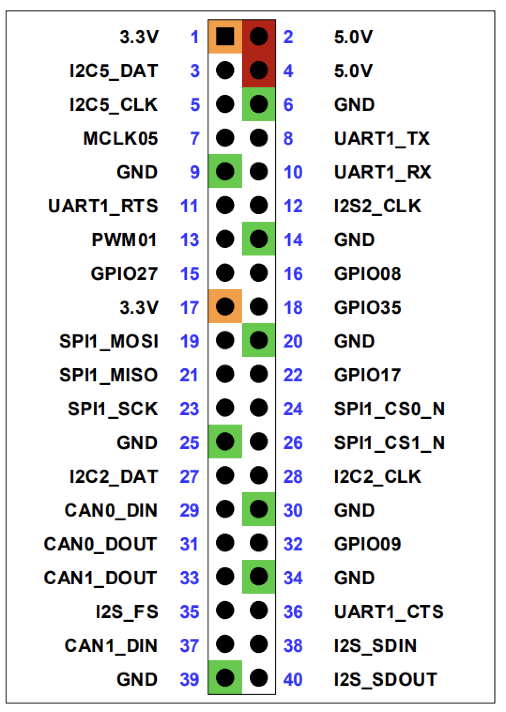

# LED Indicator

This package is built for the hardware running the LED indicator of the current safety status of the robot.


<p align="center">

</p>

Hardware Parts:

* [Nvidia Jetson AGX Orin](amazon.com/NVIDIA-Jetson-Orin-64GB-Developer/dp/B0BYGB3WV4/ref=sr_1_3?crid=GTXSI9K5SPXE&dib=eyJ2IjoiMSJ9.EY0iLDd0M9dkGkWsLUJY8JgRC1axHXpRXN6xSCAmfW80B3VoOB_IaVKeaEwHYxkFfC1MJ5qFwkMJQHtMfizDsl6CfTwee_-sI0bJQNDALmNmHNrhyqn4_aYVmiE2hrVdfLzKcLanURBZ42JfCXyXkfRG4ER1OYQPzJkBHD1PY9FTTZ4afUc3vM2vHeWegmoAC_iJHG8eFxTZp0WVB4nVSd9VHRAOZ_XJHPyTkG_B9Co.Yh00C42prgxBCz6qH8H7dRqbjLIoUr-7m5RKSnvOX7Y&dib_tag=se&keywords=nvidia+jetson+orin&qid=1760927882&sprefix=nvidia+jetson+orin%2Caps%2C126&sr=8-3&ufe=app_do%3Aamzn1.fos.5998aa40-ec6f-4947-a68f-cd087fee0848)
* [LED Light Indicator](https://www.amazon.com/SZSSXPL-Interior-Waterproof-Navigation-Courtesy/dp/B0DLTY8FJ3/ref=sr_1_14_sspa?crid=335MT7SKRUZ49&dib=eyJ2IjoiMSJ9.dKxjkiEY3GcL6QrdMzn-dbRJbyjqWUr7zN1m22_nViZdtLNCBcAjJ9U9B-dFgsbyEn0qSO3KonP7-FWVHvg9FTFR3rIyVdejO3oBx6DkW-7gcATM9j9B8lISpttCXTY5_3T3WiRcIavXmP9XqXa-hiaki-G9vyYE2xAzDF-jK8Owgn8o6LzMlIqfXIIGCHR1R6cwhrecy79T298WPptQ4VZf3iphYVY4l73Z0zSXBRXP_vByG0v2B7YiFKd2ZGbkzZbCo55ndECnhw4uOoRE7_tkK2ztUpniA7uikRQI-8w.ChbcwvJvR5BYUrc2M9orurvrmxfUkcDD9nOBbnfvME4&dib_tag=se&keywords=cruise%2Bled&qid=1760927860&sprefix=cruise%2Bled%2Caps%2C134&sr=8-14-spons&sp_csd=d2lkZ2V0TmFtZT1zcF9tdGY&th=1)
* [DC Buck Converter (Down to 19V)](https://www.amazon.com/WSOLDMA-Power-Converter-380W-Regulator/dp/B0FD3N74PX/ref=sr_1_5?crid=3LT91008OIPJN&dib=eyJ2IjoiMSJ9.3bP993nCub1Tu_8Owz16QEohUsW8tZRbV6Ci6QRBBTUVjjfa8iXLebjSQJxWPzENwwXcdcptmMifTuER0PGfp0iHmKXrI8xww-GmPmGdsZz0Mo_Bb_BjjJUhG8c0paYy92g66j4Zc8QK54n-2YikvdkbiDOq0Dv37dk5Z4KKYRBArOaIhjjsqNfSB6bEjvbqfTw1DsOxS1P0CbFeEBr0Lazx5CwWNKr994TKf1-Gwg8.oxAwnvlPzWf86-opbN9tCPO2e1pu4Y3GAs4003v5n4c&dib_tag=se&keywords=dc+buck+converter+19v&qid=1760927773&sprefix=dc+buck+converter+19v%2Caps%2C102&sr=8-5)
* [5V Relay Module Board](https://www.amazon.com/AEDIKO-Channel-Optocoupler-Isolation-Support/dp/B095YFJ69T/ref=sr_1_6?dib=eyJ2IjoiMSJ9.lFuR0w3vVJBfcJd6U3GDz3nveE-vZmFloFOeo4djgP8foj0mcJgPwWoFPvzGEkuApeIeTYixaEXNZ3LoM0NXtz5A8-GNoYPdIw4P4IpT0RCnyphfpK0-qmAjLOKd209v42GHg1hBFGGHvBGs9cITbyOBV2AOsyfZOdEhPvZYoe6XLZJz0iF5FXW1Y6uf0LEEVaUuAtf9XSV9CfRKO_S8gMpv02Cq8ZUt2HyEYY271pE.nRLPElfHwCEJdPfyuzG4Vzkjhmgi0CJngdPf37F5iQs&dib_tag=se&hvadid=694960905560&hvdev=c&hvexpln=67&hvlocphy=9016921&hvnetw=g&hvocijid=10288365099145971698--&hvqmt=e&hvrand=10288365099145971698&hvtargid=kwd-888657369097&hydadcr=27082_14699453&keywords=relay%2Bmodule%2Bamazon&mcid=334f599df5ed3dad946cdafcbb1f6aba&qid=1760927735&sr=8-6&th=1)

## Jetson AGX Orin

Below are the pinouts of Jetson, for more details, please refer to [Jetson Pinout](https://jetsonhacks.com/nvidia-jetson-agx-orin-gpio-header-pinout/).

<p align="center" style="display: flex; justify-content: center; align-items: center; gap: 10px;">
  
  
</p>

```bash
cd ~/ros2_ws
colcon build --packages-up-to go2_description --symlink-install
```

```bash
sudo apt-get install busybox
```

```bash
sudo busybox devmem <32-bit address>
```

For example, if you want to turn the pin GPIO27 (Board 15) into a GPIO, then 

```bash
python gpio_pinmux_lookup.py 15
```

Then you will get a result (e.g., 0x2440020)

```bash
sudo busybox devmem 0x2440020 w 0x0
```

For more details, please refer to [Nvidia Manual](https://docs.nvidia.com/jetson/archives/r36.2/DeveloperGuide/HR/JetsonModuleAdaptationAndBringUp/JetsonAgxOrinSeries.html#pinmux-changes).